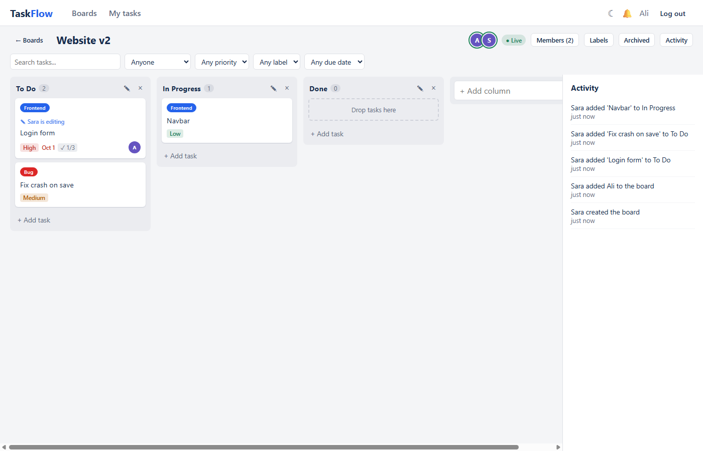
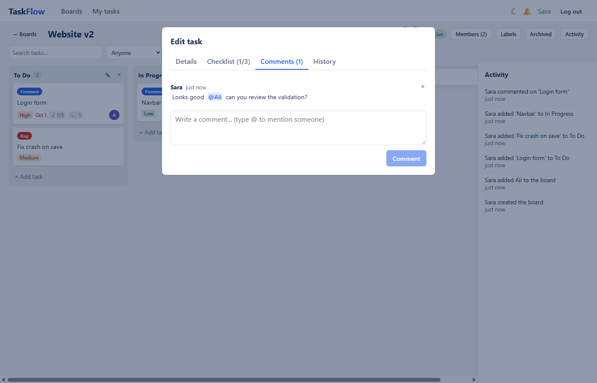
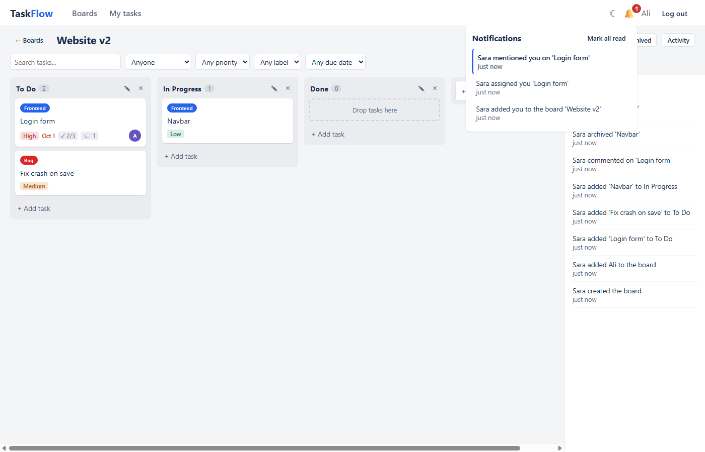
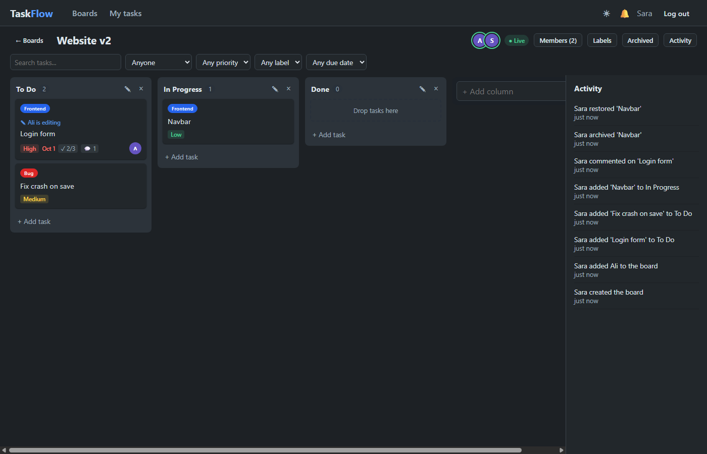
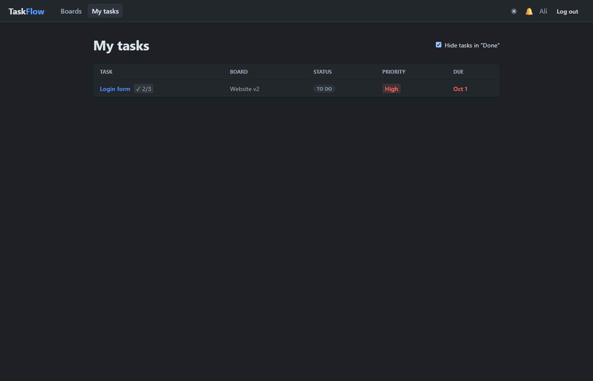
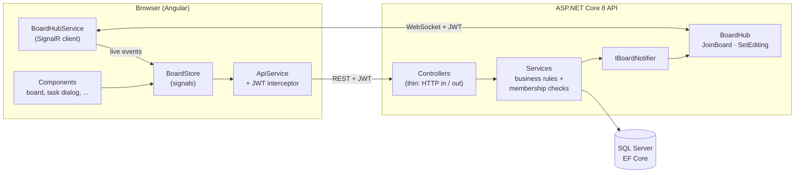
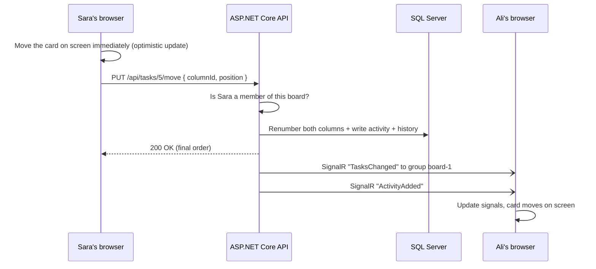

# TaskFlow

**A real-time team task board — a mini Trello.** Create boards, invite teammates and move tasks between columns by drag and drop. When one person changes something, everyone else on the board sees it instantly, without refreshing.

Built with **ASP.NET Core 8, SignalR, EF Core, SQL Server and Angular**.

| | |
|---|---|
| **Live demo** | _Coming soon — being deployed to Azure_ |
| **Demo login** | Click **“Try the demo”** on the login page, or sign in with `demo@taskflow.example` / `Demo1234!` |

> The demo account is shared and its data resets every day. Open the demo in two browser windows to see the real-time updates.

---

## Screenshots

**Live collaboration:** Ali sees that Sara is editing the “Login form” task, plus who is online, labels, checklist progress and the activity feed.



| Comments with @mentions | Real-time notifications |
|---|---|
|  |  |

| Dark mode | My tasks across all boards |
|---|---|
|  |  |

---

## Features

**Boards and teams**
- Register and log in with JWT authentication. Passwords are hashed by ASP.NET Core Identity, and accounts lock after repeated failed logins.
- Create, rename, archive, restore and delete boards.
- The owner invites members by email (they must already have an account). There are two roles: **Owner** and **Member**.
- Users only ever see boards they belong to.

**Columns and tasks**
- Default columns are *To Do / In Progress / Done*. You can add, rename, reorder (drag) and delete them.
- Each task has a title, description, assignee, due date, priority (Low / Medium / High) and coloured labels.
- Drag and drop tasks within and between columns (Angular CDK).
- **Checklists** inside tasks, with a `2/5` progress counter on the card.
- **Comments** with **@mentions**: typing `@` suggests board members, and mentions are highlighted.
- **Task history**, e.g. “Sara changed priority from Low to High”.
- **Archive instead of delete**: archived tasks can be restored or deleted for good.
- **Search and filters** by text, assignee, priority, label and due date (overdue / next 7 days).

**Real-time (SignalR)**
- Every change (tasks, columns, labels, checklists, comments) appears instantly for everyone on the board.
- Shows who is **online** on the board.
- Shows **“Sara is editing”** on a card while someone has that task open.
- **Notifications** are pushed live when someone assigns you a task, mentions you, comments on your task or adds you to a board.
- Activity log per board, e.g. “Sara moved ‘Login page’ to Done”.

**Safe concurrent editing**
- If two people edit the same task, the second save does **not** silently overwrite the first. They see *“This task was updated by someone else”* and can **load their version** or **keep my changes**.

**And also**
- A **“My tasks”** page lists everything assigned to you across all boards.
- **Dark mode**, remembered per browser.
- A profile page where you can change your name and password.
- **“Try the demo”** for one-click access to a seeded sample board.

---

## Tech stack

| Layer | Technology |
|---|---|
| Frontend | Angular 22 (standalone components, signals), Angular CDK drag and drop, `@microsoft/signalr`, plain CSS with CSS variables |
| Backend | ASP.NET Core 8 Web API, SignalR, ASP.NET Core Identity, JWT bearer authentication, built-in rate limiting |
| Data | Entity Framework Core 8, SQL Server (LocalDB for development, Azure SQL in production) |
| Tests | xUnit with an in-memory SQLite database (28 tests: permissions, task moves, concurrency, features) |
| Hosting (planned) | Azure Static Web Apps (frontend), Azure App Service (API), Azure SQL Database; GitHub Actions for CI/CD |

---

## Architecture



**Project layout**

```
server/
  TaskFlow.Api/
    Controllers/   thin controllers, one per resource
    Services/      business rules: BoardService, TaskService, CommentService, ...
    Hubs/          BoardHub, PresenceTracker (who's online / editing), IBoardNotifier
    Entities/      EF Core entities (Board, Column, TaskItem, Comment, Notification, ...)
    Data/          AppDbContext + migrations
    Dtos/          request / response records
  TaskFlow.Tests/  xUnit tests (in-memory SQLite)
client/
  src/app/
    core/          API client, auth, SignalR hub service, notifications, theme
    pages/         login, boards, board (store + dialogs), my-tasks, profile
    shared/        toasts, small formatting helpers
```

---

## How real-time works

1. **One group per board.** When you open a board, the Angular app calls the hub method `JoinBoard(boardId)`. The server **checks that you are a member** and adds your connection to the SignalR group `board-{id}`.
2. **Changes go through the REST API**, not the hub. That way every change is validated, permission-checked and saved in one place.
3. **After saving, the server broadcasts** an event (`TaskUpserted`, `TasksChanged`, `ColumnsChanged`, `CommentAdded`, ...) to that board's group only.
4. **Every open tab applies the event** to its signals and Angular re-renders. Events replace items by id, so receiving one twice is harmless.

What happens when Sara drags a card:



**Other real-time details**
- **Notifications** use a per-user channel (`Clients.User(userId)`), so they arrive on any page, not only inside a board.
- **Presence** (“online” and “is editing”) is tracked per SignalR connection in memory and cleared when a tab closes.
- **Reconnects:** after a dropped connection the client rejoins the board and reloads it, in case it missed any events.

### Concurrency: no silent overwrites

`TaskItem.RowVersion` is a SQL Server `rowversion` column. The database changes it on every update.

1. The client receives the task together with its `rowVersion`.
2. When saving, the client sends that `rowVersion` back.
3. EF Core runs `UPDATE ... WHERE Id = @id AND RowVersion = @original`. If someone else saved in between, **no row matches**, and EF throws `DbUpdateConcurrencyException`.
4. The API returns **409 Conflict** with the latest version, and the dialog lets the user choose what to keep.

Checklist items and comments are stored in their own tables. Ticking a box or posting a comment therefore never changes the task's `RowVersion`, so it never causes a false conflict.

---

## Security

- **No secrets in git.** The JWT signing key and connection string come from `dotnet user-secrets` locally and from App Service settings / environment variables in Azure. The app refuses to start without them.
- **Membership is checked on every API call and on every SignalR `JoinBoard`.** Owner-only actions (rename, archive, delete, invite, remove members) are checked on the server, not just hidden in the UI.
- **Passwords** are handled by ASP.NET Core Identity (hashed and salted), with account lockout after 5 failed attempts.
- **Rate limiting** on login, register, the demo login and change password: 10 requests per minute per IP.
- **CORS** only allows the configured frontend URL.
- **HTTPS + HSTS** outside development.
- **SignalR authentication:** browsers can't send headers on WebSockets, so the JWT is sent as `access_token` in the query string, and the server only accepts it on the `/hubs` path.
- **Demo account protections:** the demo account can't change its password or profile, and the demo board can't be deleted or archived and its members can't be changed. Demo data resets daily.
- **Generic errors:** unexpected exceptions return a generic 500 without stack traces. Known errors return friendly JSON (`400/403/404/409`).

---

## Running locally

**Prerequisites:** [.NET 8 SDK](https://dotnet.microsoft.com/download) (or newer), [Node.js 20+](https://nodejs.org) and SQL Server LocalDB (installed with Visual Studio, or available separately).

### 1. API

```powershell
cd server/TaskFlow.Api

# One-time: store the secrets outside the repo
dotnet user-secrets set "ConnectionStrings:Default" "Server=(localdb)\mssqllocaldb;Database=TaskFlow;Trusted_Connection=True;TrustServerCertificate=True"
dotnet user-secrets set "Jwt:Key" "<any random string of at least 32 characters>"

dotnet run --launch-profile http
```

The API runs at http://localhost:5080, with Swagger at http://localhost:5080/swagger. On first start it creates the database (EF Core migrations) and seeds the demo board.

### 2. Frontend

```powershell
cd client
npm install
npm start
```

Open http://localhost:4200.

### 3. Tests

```powershell
cd server
dotnet test
```

### Try the real-time features

1. Open http://localhost:4200 in a normal window and register as **Alice**.
2. Open an **InPrivate / Incognito** window and register as **Bob**.
3. As Alice, create a board, click **Members** and invite Bob's email.
4. Open the board in both windows. Drag a card, add a comment with `@Bob`, open a task to see “is editing”, or edit the same task in both windows to see the conflict message.

---

## API overview

| Area | Endpoints |
|---|---|
| Auth | `POST /api/auth/register` · `login` · `demo` · `GET me` · `PUT profile` · `POST change-password` |
| Boards | `GET/POST /api/boards` · `GET/PUT/DELETE /api/boards/{id}` · `POST {id}/archive` · `POST {id}/restore` · `GET {id}/activity` · `GET {id}/archived-tasks` |
| Members | `POST /api/boards/{id}/members` · `DELETE /api/boards/{id}/members/{userId}` |
| Columns | `POST /api/boards/{id}/columns` · `PUT /api/boards/{id}/columns/order` · `PUT/DELETE /api/columns/{id}` |
| Labels | `POST /api/boards/{id}/labels` · `PUT/DELETE /api/labels/{id}` |
| Tasks | `POST /api/tasks` · `PUT/DELETE /api/tasks/{id}` · `PUT {id}/move` · `POST {id}/archive` · `POST {id}/restore` · `GET {id}/details` · `GET /api/tasks/mine` |
| Checklist / comments | `POST /api/tasks/{id}/checklist` · `PUT/DELETE /api/checklist/{id}` · `POST /api/tasks/{id}/comments` · `DELETE /api/comments/{id}` |
| Notifications | `GET /api/notifications` · `POST {id}/read` · `POST read-all` |
| SignalR hub | `/hubs/board`, with methods `JoinBoard`, `LeaveBoard` and `SetEditing` |

Full interactive documentation is in Swagger when running locally.

---

## Future improvements

- **Scale out real-time:** move presence to Redis and use Azure SignalR Service so the API can run on several servers.
- **Refresh tokens and HttpOnly cookies** instead of keeping the JWT in `localStorage`.
- **File attachments** on tasks (Azure Blob Storage).
- **Email invitations and notifications** for people who aren't online.
- **Undo** for moves and deletes, and a per-column work-in-progress limit.
- **End-to-end tests** (Playwright) and frontend unit tests for `BoardStore`.
- **Board templates** and a calendar view of due dates.
- **Accessibility pass:** keyboard drag and drop and screen-reader announcements for live updates.

---

## Author

**Sara**, Computer Science student. Built as a portfolio project to practise real-time web apps with ASP.NET Core and Angular.
